<div align="center">

# 🤖🔓 Letting Claude Crack a Password: JTR via HexStrike MCP

**Optional Week 3 lab — cracking `hash3.networkwalks_flag1.pdf` by asking Claude Desktop to drive John the Ripper itself, through the HexStrike AI MCP server**
</div>

<p align="center">
  
  
  
  
  
</p>

---

## 📌 Project Overview

This is an **optional but important** Week 3 lab from the Networkwalks Cybersecurity internship: **Password Cracking with JTR + AI — HexStrike MCP Edition**. It builds directly on two earlier labs: **[W3-PM1 (Password Cracking with JTR)](https://github.com/philip-ajik/NETWORK-WALKS-W3-PM1---Week3---Project-Module1---Password-Cracking-with-JTR-v1)**, where I ran John the Ripper myself from the command line, and **[the HexStrike MCP setup lab](https://github.com/philip-ajik/NETWORK-WALKS-W3-HexStrike-MCP-Setup)**, where I got Claude Desktop talking to HexStrike AI's tools.

This time the task is to let the AI do the cracking: instead of typing `pdf2john` and `john` myself, I asked **Claude Desktop**, through the **HexStrike AI MCP server**, to check whether John the Ripper is available, hash the target PDF, and crack it, in plain English prompts. I ran this on 20 November 2026.

Before I could run the lab's actual prompts, HexStrike's server had stopped working since my last shutdown, so there's a short recovery story here too, with help from an AI assistant in the browser.

| 🔎 Item | ✅ Result |
| ------- | --------- |
| Target file | `hash3.networkwalks_flag1.pdf` |
| Tool | John the Ripper 1.9.0-jumbo-1 (bleeding-edge build), driven entirely through HexStrike AI's MCP tools |
| Wordlist | `rockyou.txt` |
| **Cracked password** | **`password1`**, returned instantly because John's own cracked-password cache already held it from a prior run |
| Confirmed by | Opening the PDF; flag `nw{networkwalks_flag1_jtr_270521_1}` |
| Setback | HexStrike's server wouldn't start after a reboot; fixed with help from an AI assistant |

---

## 🎯 Objectives

- Get the HexStrike AI MCP server running again after it stopped surviving a reboot
- Ask an AI agent, in natural language, to confirm a security tool's presence and version
- Ask the same agent to compute a file's hash and then crack a password-protected PDF with John the Ripper
- Watch how the agent handles a wrong file path on its own, without being told the fix
- Confirm the cracked password by actually opening the file

---

## 🛡️ Why This Matters for Security

This lab is a small but real example of agentic security tooling: instead of a human running every command, an AI agent with access to a toolkit can carry out a multi-step task (check a tool, hash a file, run an attack, report the result) from a single plain-language instruction. That convenience comes with a responsibility to understand what the agent actually did, not just trust its summary; this write-up follows its reasoning step by step rather than only reporting the final password.

It is also a reminder that agent-driven tools inherit the same environment problems as manual ones. HexStrike's server here failed for an ordinary reason (its Python virtual environment wasn't active), and the AI only solved it because I went and looked at the actual terminal output with it, the same habit that mattered in the manual JTR lab.

> ⚠️ **Important:** `hash3.networkwalks_flag1.pdf` is a training file supplied by Networkwalks for this lab. Letting an AI agent run password-cracking and other offensive tools should only ever happen against files and systems you own or have explicit permission to test, and ideally with the agent's actions reviewed, not blindly trusted.

---

## ⚙️ Lab Configuration

| 🧩 Component | ⚙️ Configuration |
| ------------ | ---------------- |
| 🖥️ Platform | Kali Linux VM, Claude Desktop connected to the HexStrike AI MCP server (set up in the companion lab) |
| 🛠️ Tool used by the agent | John the Ripper 1.9.0-jumbo-1+bleeding-edge, at `/usr/sbin/john` |
| 🎯 Target | `hash3.networkwalks_flag1.pdf`, copied to the Kali Desktop |
| 📖 Wordlist | `rockyou.txt` |
| 🏆 Scoring | None; the PDF opens to a "Congratulations" flag page |

---

# 🪜 Lab Procedure

## Step 0. Getting HexStrike running again
The lab's first step is to copy the target PDF to the Kali Desktop, which I had already done.


Before I could run the lab's prompts, I asked Claude to check John the Ripper, and it reported it couldn't reach HexStrike at all.

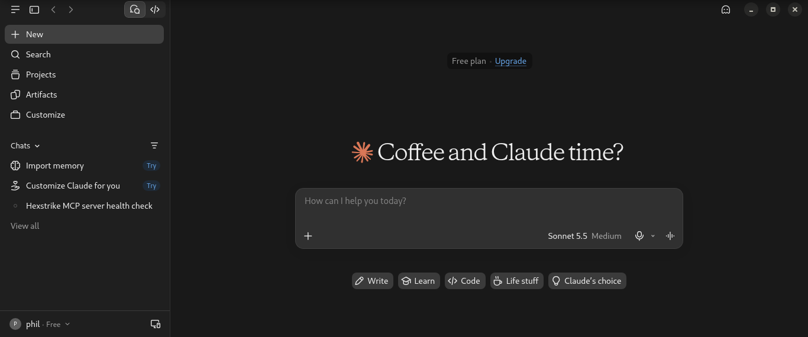

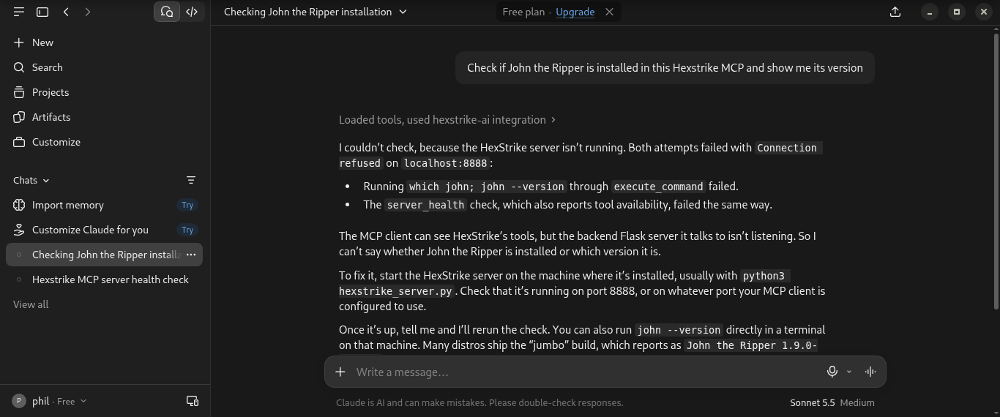

Claude's own diagnosis was precise: the MCP client could see HexStrike's tool definitions, but the backend Flask server itself wasn't listening on port 8888, meaning the server process from my last session hadn't survived the shutdown.

I took the actual terminal error to an AI assistant in the browser for a second opinion while trying to restart the server.

```
I'm trying to run hexstrike-ai on my kali linux, it had working before
my last shutdown now this was the error I am getting: ...
```

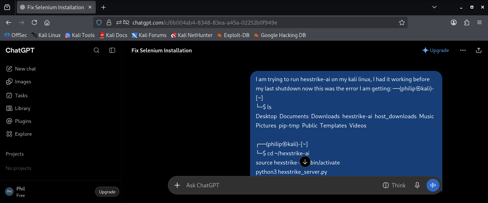

The assistant read the terminal output and concluded that HexStrike's server was running with a Python interpreter that couldn't find the `selenium` package, likely because the server had been started without activating its virtual environment first, using the system Python instead of the one inside `hexstrike-env`.

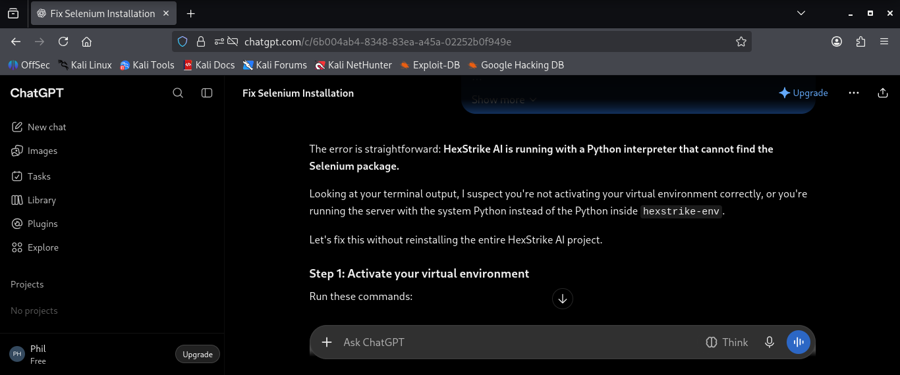

**Step 1, suggested by the assistant: activate the virtual environment.**

```bash
cd ~/hexstrike-ai
source hexstrike-env/bin/activate
```

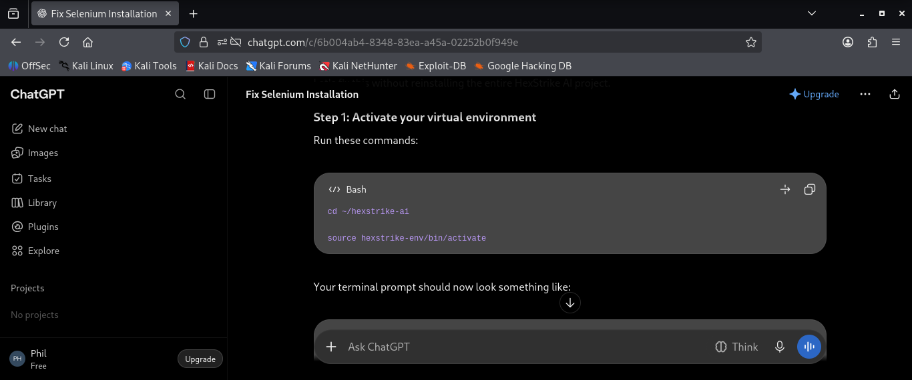

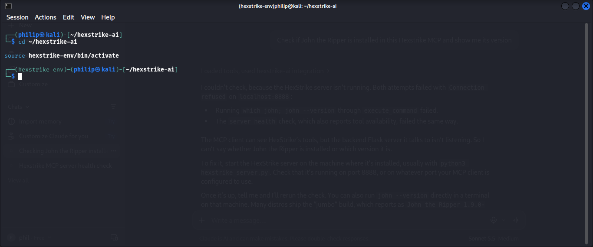

**Step 2: verify which Python is actually in use.**

```bash
which python
which pip
python --version
```

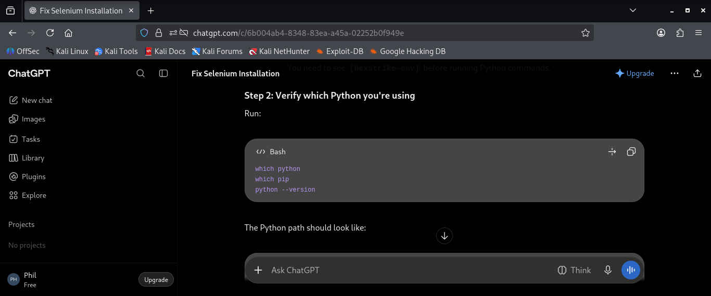

Both `python` and `pip` already pointed correctly into `hexstrike-env`, confirming the virtual environment itself was intact; the problem really had been that an earlier attempt to start the server simply hadn't activated it first.

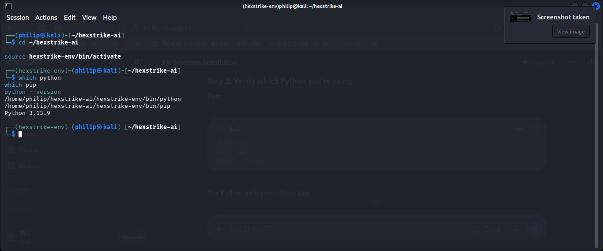

**Step 3: install Selenium, just to be sure.**

```bash
python -m pip install selenium
```

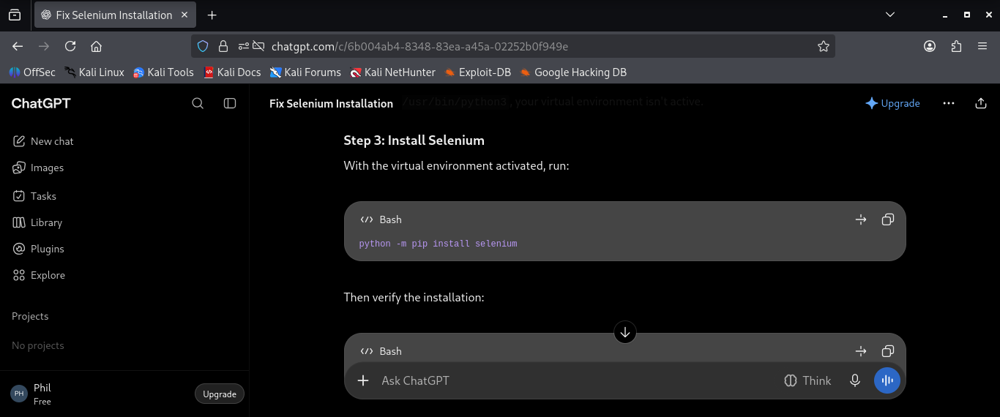

Every line came back "Requirement already satisfied," confirming Selenium, and its own dependencies, had been there all along.

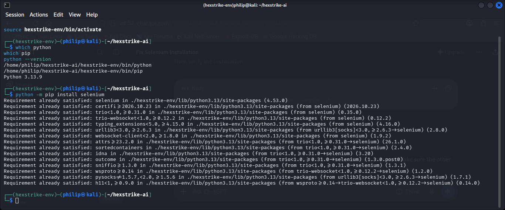

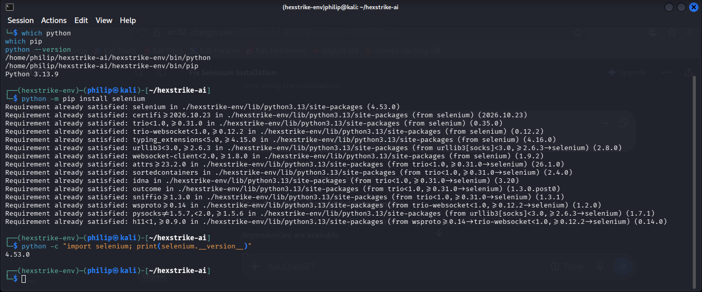

**Step 4: reinstall the project's full requirements, to rule out anything else.**

```bash
python -m pip install -r requirements.txt
```

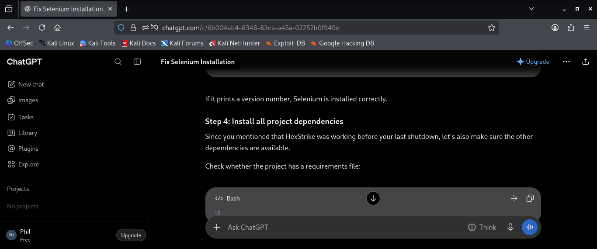

Again, everything was already satisfied, line after line.

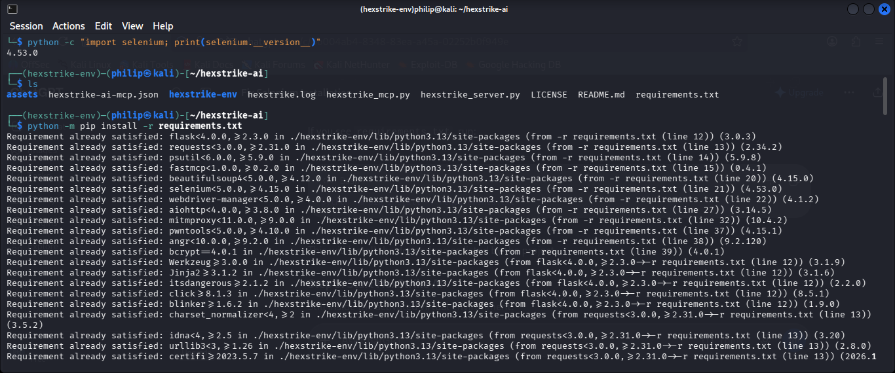

**Step 5: start the server, now that it's definitely running inside the virtual environment.**

```bash
python hexstrike_server.py
```

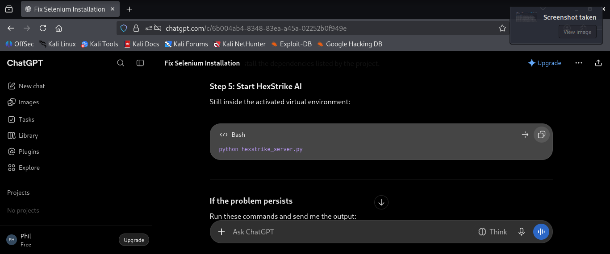

The server started cleanly with its full HEXSTRIKE banner, listening on port 8888 as expected.

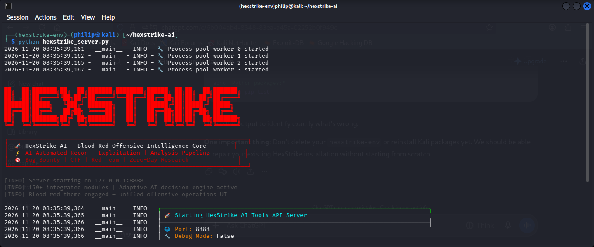

**With the server back up, I could finally run the lab's own prompts.**

## Step 1. Confirm John the Ripper is available
**Prompt:** *"Check if John the Ripper is installed in this Hexstrike MCP and show me its version"*

Claude used the HexStrike integration to check directly and reported John the Ripper installed at `/usr/sbin/john`, version **1.9.0-jumbo-1+bleeding-edge** (the community "jumbo" build, dated 2021-11-02). It noted that this build doesn't recognise a plain `--version` flag, so it read the version from the tool's own banner output instead.

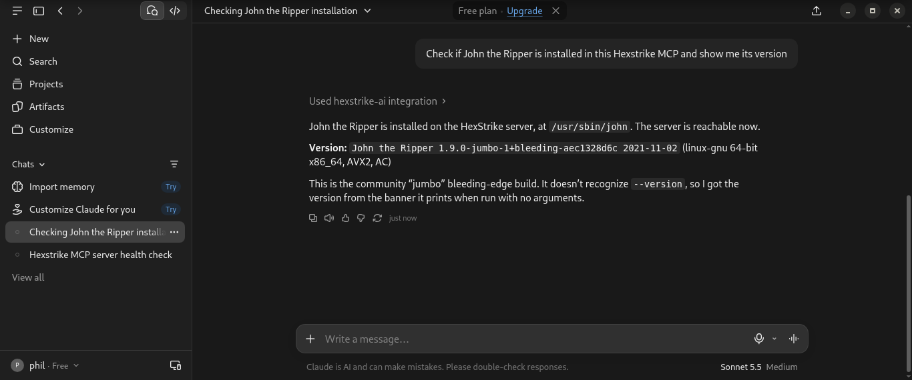

## Step 2. Ask Claude to hash the target PDF
**Prompt:** *"Please calculate the hash value of this PDF file: /home/kali/Desktop/hash3.networkwalks_flag1.pdf"*

The lab's own sample prompt uses the path `/home/kali/Desktop/...`, matching the instructor's demo machine, not mine. Claude caught this itself: it reported the file didn't exist at that path, checked the Desktop directly, and found it at `/home/philip/Desktop/hash3.networkwalks_flag1.pdf` instead, without needing to be told the correction.

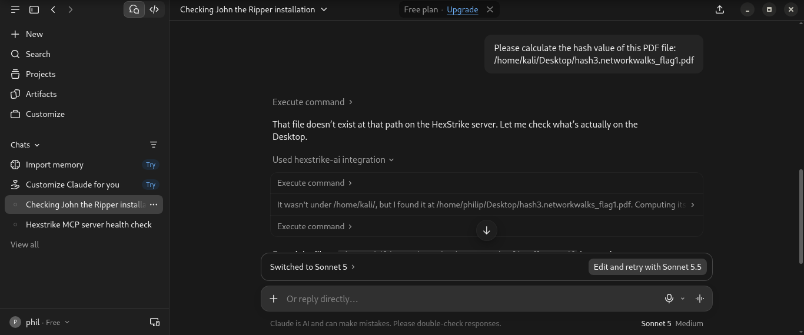

It then reported the file's MD5, SHA-1, and SHA-256 hashes.

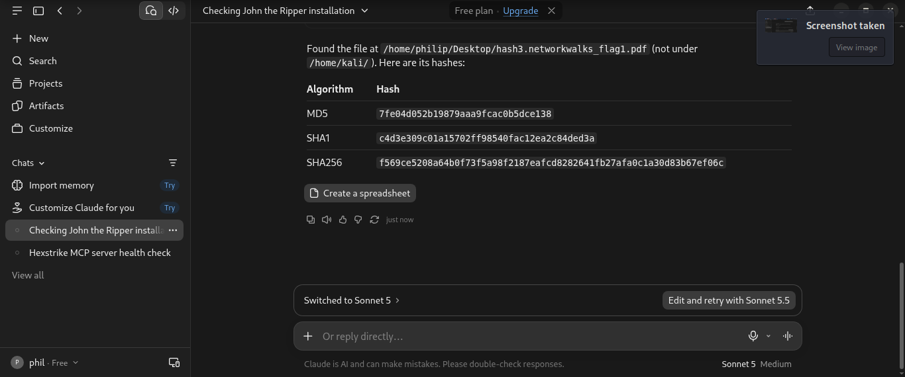

## Step 3. Ask Claude to crack it with John the Ripper
**Prompt:** *"Please use JTR tool in this hexstrike MCP server to crack the password of this PDF file. Use the rockyou.txt wordlist dictionary."*

Claude cracked it and reported back: **PDF password: `password1`**.

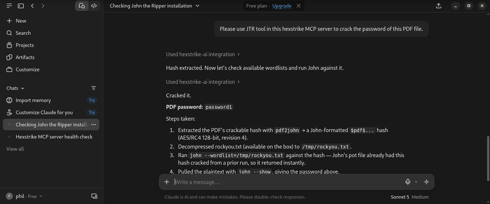

It also explained exactly what it had done, step by step:

1. Extracted the PDF's crackable hash with `pdf2john`, a John-formatted `$pdf$...` hash (AES/RC4, 128-bit, revision 4).
2. Decompressed `rockyou.txt` (already available on the box) to `/tmp/rockyou.txt`.
3. Ran `john --wordlist=/tmp/rockyou.txt` against the hash. John's own cracked-password cache (its `.pot` file) already held this hash from a prior run, so it returned the match instantly rather than needing to search.
4. Pulled the plaintext back out with `john --show`.

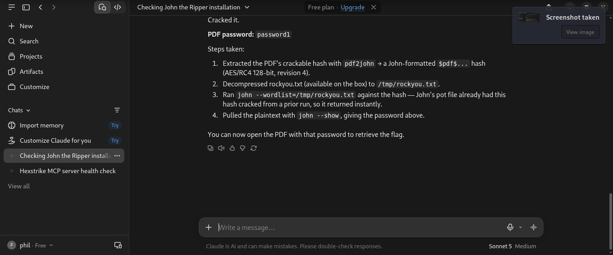

## Step 4. Confirm by opening the PDF
I opened `hash3.networkwalks_flag1.pdf` and entered `password1`.

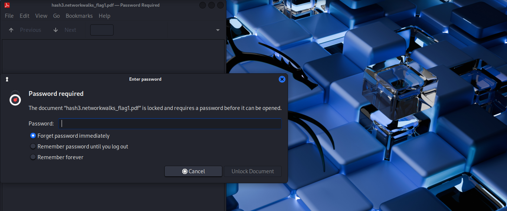

It opened, with the flag **`nw{networkwalks_flag1_jtr_270521_1}`**.

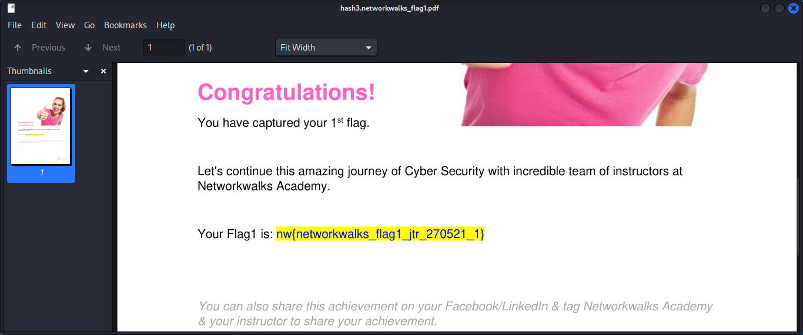

**Confirmed: `password1` is the correct password, cracked entirely through natural-language prompts to Claude Desktop, with HexStrike AI driving John the Ripper underneath.**

---

# 📊 Results

| # | 🎯 Step | ✅ Result |
| - | ------- | --------- |
| 0 | Recover HexStrike's server | Fixed: virtual environment wasn't active when the server was last started |
| 1 | Confirm John the Ripper | Installed, version 1.9.0-jumbo-1+bleeding-edge, at `/usr/sbin/john` |
| 2 | Hash the target PDF | Found the file at a corrected path (`/home/philip/...`, not the lab's `/home/kali/...`); MD5/SHA-1/SHA-256 reported |
| 3 | Crack the hash | **`password1`**, returned instantly from John's own cracked-password cache |
| 4 | Confirm | PDF opens; flag `nw{networkwalks_flag1_jtr_270521_1}` |

*Footnote: the lab has no result card or score; the correct password is confirmed by the PDF actually opening and showing its flag text.*

### Timeline (20 November 2026)
| ⏱️ Time | 🔄 What happened |
| ------- | ---------------- |
| 08:19–08:21 | Asked Claude to check John the Ripper; HexStrike unreachable (connection refused) |
| 08:30–08:35 | AI-assisted recovery: activated the venv, verified Python, confirmed Selenium and all requirements were already satisfied, started the server cleanly |
| 08:37 | Claude confirms John the Ripper 1.9.0-jumbo-1+bleeding-edge is installed |
| 08:39 | Claude locates the PDF at the corrected path and reports its hashes |
| 08:42 | Claude cracks the hash: `password1` |
| 08:45 | PDF opened with the cracked password; flag captured |

---

# 🔭 Observations Beyond the Task Questions

1. **The same lesson as the manual JTR lab showed up again, automatically this time.** John's `.pot` file already held this hash from a previous crack, so the "attack" actually just looked up a cached answer instantly; Claude's own explanation made this transparent rather than presenting it as a fresh brute-force result.
2. **Claude corrected a wrong file path on its own, without being asked to.** The lab's sample prompt hardcodes `/home/kali/Desktop/...`; Claude checked, found the file wasn't there, searched the Desktop, and used the real path, the same fix I had to do manually for the MCP config file in the HexStrike setup lab.
3. **The underlying cause of the server outage was ordinary, not exotic.** A Selenium "not found" error looked like a missing dependency, but the virtual environment itself was fully intact the whole time; the real issue was simply that the server process had been started without activating it.
4. **The flag format is consistent across this whole mini-series of labs** (`nw{...}`-style tokens tied to the specific tool used, here `jtr`), which makes it easy to confirm which exercise a given capture belongs to.
5. **Agentic tool use still benefits from reading what the agent actually did**, not just its final answer. Claude's own "Steps taken" summary made the crack auditable in a way a bare "password1" would not have been.

---

# 🐞 Challenges Encountered

* **Issue: HexStrike AI's server didn't survive a reboot**, and a first attempt to start it manually failed with an error that looked like a missing `selenium` package.
  **Resolution:** An AI assistant read the actual terminal output and correctly identified the real cause: the server had been started with the system Python rather than the one inside `hexstrike-env`. Activating the virtual environment, then confirming `which python`/`which pip` pointed into it, resolved the problem; reinstalling Selenium and the full requirements file only confirmed everything had already been installed correctly.
  **What I'll do differently:** Always `source hexstrike-env/bin/activate` as the very first step before starting the server, and check `which python` immediately if any import-related error appears, rather than assuming a package is missing.

* **No blockers in the actual password-cracking task.** Once HexStrike was back up, all three prompts to Claude (check the tool, hash the file, crack it) worked as described in the lab guide, including Claude correctly recovering from the lab's hardcoded `/home/kali` path on its own.

---

# 💡 Key Learnings

1. An import error naming a specific missing package doesn't always mean the package is actually missing; it can mean the wrong Python interpreter is running altogether.
2. Checking `which python` and `which pip` is a fast, reliable way to confirm a virtual environment is actually active, faster than reinstalling everything and hoping.
3. An AI agent with tool access can complete a multi-step security task from one plain-language prompt, but its own explanation of what it did is what makes that result trustworthy and checkable.
4. The same operational habits from manual tool use, like checking whether a hash has already been cracked before, or verifying a hardcoded file path, still apply when an AI agent is the one running the tools.
5. Keeping the activation step first, every time, before starting a service that depends on a virtual environment would have avoided this whole detour.

---

# 🔐 Security & Ethical Use

This work is for education only. `hash3.networkwalks_flag1.pdf` is a training file supplied by Networkwalks for this lab. Giving an AI agent access to security tools like John the Ripper through an MCP server should only ever be done in a controlled practice environment, against files and systems you own or have explicit permission to test, with the agent's actions reviewed rather than trusted blindly.

---

# 🔗 Tools & Resources

- **John the Ripper:** https://www.openwall.com/john/
- **HexStrike AI:** https://github.com/0x4m4/hexstrike-ai
- **NetworkWalks:** https://networkwalks.com

---

# 👤 Author
**Philip Ajik**
Cybersecurity Student (Batch B082) — Networkwalks Academy
LinkedIn: https://www.linkedin.com/in/philip-ajik-a22944384

---

## 📌 Project Information
**Program Name:** Cybersecurity at Networkwalks | **Task:** Week 3 Optional Lab | **Project:** Password Cracking with JTR + AI (HexStrike MCP Edition) | **Repository:** GitHub
